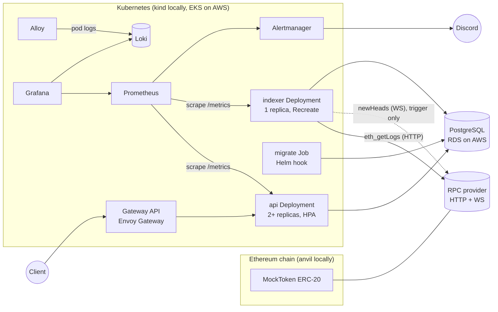

# Gapless

[](https://github.com/roudra323/Gapless/actions/workflows/ci.yml)

A resilient ERC-20 `Transfer` indexer and read API, built as a **DevOps and observability** project: Kubernetes, Helm, Terraform for AWS, GitHub Actions, Prometheus, Grafana, Alertmanager and Loki.

The app is deliberately small. The engineering is the point: the indexer never loses or repeats an event, whatever fails (WebSocket drops, flaky RPC, chain reorgs, pod kills, two copies running at once), and every one of those failures is **tested in CI**, **visible on a dashboard**, and **alerted on** with a runbook.

> **Status:** Phase 9a done. The full AWS stack (VPC, EKS, RDS, ECR, IAM/OIDC, Secrets Manager, budget) is in Terraform and is applied and destroyed on every infra PR against a local AWS emulator. Next: 9b, the real AWS run and the deploy pipeline. Roadmap: [`docs/01`](docs/01-overview-and-roadmap.md).

## Architecture



| Part      | What it does                                                                                                         |
| --------- | -------------------------------------------------------------------------------------------------------------------- |
| `indexer` | Pulls `Transfer` logs in confirmed block ranges and writes them to Postgres. Exactly one writer, enforced by a lock. |
| `api`     | Read-only REST API (NestJS): recent transfers, transfers by address (cursor pagination), indexer stats.              |
| `migrate` | Drizzle SQL migrations, run as a Helm pre-install/pre-upgrade hook Job.                                              |
| Platform  | Envoy Gateway, kube-prometheus-stack, Loki + Alloy, metrics-server, HPA and PDB, all from one Helm chart and `make`. |

Details: [`docs/02-architecture.md`](docs/02-architecture.md).

## How it stays correct

The core rule: **the checkpoint in the database is the truth, and the WebSocket is only a doorbell.** A new-block notification only wakes the indexer up; what to fetch always comes from the checkpoint, so a lost or late notification can never cause a gap. A poll timer covers the case where the doorbell is broken.

Invariants ([`docs/03`](docs/03-indexer-design.md)):

- **No gaps:** ranges are contiguous from the checkpoint; a failed range is retried, never skipped.
- **No duplicates:** a primary key on `(chain_id, tx_hash, log_index)` plus `INSERT … ON CONFLICT DO NOTHING`.
- **Atomic progress:** the events and the checkpoint commit in the **same transaction**, so a crash can never move the checkpoint ahead of the data.
- **Single writer:** a Postgres advisory lock; a second indexer waits and takes over when the leader dies.
- **Reorg-safe:** only blocks behind a confirmation depth are indexed, and a block-hash check rewinds and re-indexes when the chain changes under it.

## What breaks, and how it recovers

Every scenario runs in CI against a real `anvil` chain and a real Postgres (Testcontainers), through small TCP/HTTP fault proxies. Each one ends with a **parity check**: the set of events in the database equals what `eth_getLogs` returns for the whole range.

| Failure                                               | Recovery                                                                |
| ----------------------------------------------------- | ----------------------------------------------------------------------- |
| Process killed in the middle of a batch               | The open transaction rolls back; restart resumes from the checkpoint.   |
| WebSocket dropped, or open but silent (stalled)       | Polling keeps indexing; the stall rule drops the socket and reconnects. |
| No WebSocket configured                               | Poll-only mode, same result.                                            |
| RPC returns 429, 500 or resets                        | Retry with backoff; the batch size adapts.                              |
| A lagging node behind a load balancer (empty results) | The checkpoint never moves past the height the node really has.         |
| The provider rejects a large `getLogs` range          | The range halves until it fits.                                         |
| Chain reorg, including deeper than the rewind window  | Hash check, rewind, re-index; old rows deleted, new rows in.            |
| Two indexers at once                                  | One holds the lock and writes; kill it and the other takes over.        |
| `SIGTERM` during a batch                              | The batch commits or rolls back fully, exit 0 within the timeout.       |

The list and the test setup: [`docs/06-testing.md`](docs/06-testing.md).

## Observability

- **Metrics:** Prometheus metrics for the indexer (head, processed block, lag, batches, reorgs, leader, WebSocket state, RPC calls by method and result) and the API (requests, latency, DB query time), scraped by ServiceMonitors.
- **Alerts:** 8 PrometheusRules (`IndexerLagHigh`, `IndexerStalled`, `IndexerNoLeader`, `IndexerWsDown`, `RpcErrorRateHigh`, `ApiHighErrorRate`, `ApiLatencyHigh`, `PodRestartsHigh`), unit-tested with `promtool`, routed by Alertmanager to Discord. Each alert links to its section in [`docs/runbooks.md`](docs/runbooks.md).
- **Dashboard:** a provisioned Grafana dashboard (indexer health, RPC, API, platform and logs rows; 20 panels).
- **Logs:** structured JSON logs (pino) collected by Alloy into Loki, searchable in Grafana next to the metrics.

Details: [`docs/09-observability.md`](docs/09-observability.md).

## Infrastructure as code (AWS)

Terraform in [`infra/terraform`](infra/terraform) describes the whole AWS environment ([`adr/0003`](docs/adr/0003-aws-eks-envoy-gateway.md)):

- VPC with public node subnets and private database subnets (no NAT Gateway, to keep cost low).
- EKS with a Spot managed node group, access entries and **EKS Pod Identity** roles for External Secrets Operator and the AWS Load Balancer Controller.
- RDS for PostgreSQL in the private subnets, reachable only from the cluster security group; the master password is managed by AWS.
- ECR repositories (immutable tags, scan on push), Secrets Manager entries, and a **GitHub OIDC** deployer role (no long-lived keys in CI).
- A budget alarm, and state in S3 with native S3 locking.

Every infra PR runs `terraform fmt`, `validate`, `tflint`, then a full **apply and destroy against [Floci](https://github.com/floci-io/floci)**, a local AWS emulator that starts real k3s and Postgres containers. The code is tested for $0 before it ever touches a real account ([`adr/0004`](docs/adr/0004-floci-local-aws-emulator.md)).

## CI/CD

GitHub Actions ([`docs/08`](docs/08-ci-cd.md)), with jobs that run only when their paths change:

| Job           | What it checks                                                         |
| ------------- | ---------------------------------------------------------------------- |
| `quality`     | oxlint, Prettier, `tsc`                                                |
| `unit`        | Vitest unit tests                                                      |
| `integration` | Indexer and API against anvil + Postgres (Testcontainers)              |
| `chaos`       | The failure scenarios above                                            |
| `contracts`   | `forge test` for the Solidity token                                    |
| `images`      | Docker builds for both apps (distroless, non-root), 200 MB size budget |
| `manifests`   | `helm lint --strict`, kubeconform, `promtool` rule tests               |
| `terraform`   | `fmt`, `validate`, `tflint`, then apply + destroy on Floci             |

All actions and images are pinned by commit SHA or digest, and Renovate keeps them current. Commit messages are checked locally by lefthook and commitlint.

## Tech stack

| Area          | Choice                                                                      |
| ------------- | --------------------------------------------------------------------------- |
| App           | Node.js 24, TypeScript, NestJS, viem, Drizzle ORM, PostgreSQL 18, pino, Zod |
| Chain         | Foundry (Solidity, anvil, forge), OpenZeppelin ERC-20                       |
| Containers    | Docker (multi-stage, distroless, non-root), Docker Compose                  |
| Kubernetes    | kind, Helm 4, Gateway API with Envoy Gateway, HPA, PDB, metrics-server      |
| Observability | Prometheus, Alertmanager, Grafana, Loki, Alloy, k6 for load tests           |
| Cloud and IaC | AWS (EKS, RDS, ECR, IAM, Secrets Manager), Terraform, tflint, Floci         |
| CI            | GitHub Actions, Renovate, lefthook, commitlint                              |

Versions and the rules for choosing them: [`docs/04`](docs/04-tech-stack-and-versions.md).

## Run it

Needs Node 24, pnpm (Corepack), Docker, and Foundry. For the cluster: kind, kubectl and Helm. For the infra: Terraform.

```bash
pnpm install
pnpm lint && pnpm typecheck && pnpm test   # static checks and unit tests
pnpm test:integration && pnpm test:chaos   # real chain + Postgres in containers
```

**Full stack in Docker Compose** (Postgres, anvil, migrate, indexer, API). Deploy the token and send transfers as in [`contracts/README.md`](contracts/README.md), set `TOKEN_ADDRESS` in `.env` (copy `.env.example`), then:

```bash
docker compose --profile app up -d --build --wait
curl -s localhost:3000/v1/transfers | head
```

**Local Kubernetes** with the whole monitoring stack:

```bash
make kind-up          # kind cluster, Envoy Gateway, Prometheus, Grafana, Alertmanager, Loki, Alloy
make kind-deploy      # build the images, load them into kind, helm upgrade --install
make port-forward     # Grafana, Prometheus, Alertmanager on localhost
make load             # k6 against the Gateway; watch the HPA scale the API
make kind-down
```

**AWS infrastructure, locally and for free:**

```bash
make tf-check         # fmt, validate, tflint
make floci-apply      # start Floci, create the state bucket, apply envs/dev
make floci-destroy && make floci-down
```

## Docs

| Doc                                      | Topic                                              |
| ---------------------------------------- | -------------------------------------------------- |
| [01](docs/01-overview-and-roadmap.md)    | Overview, demo, roadmap and current phase          |
| [02](docs/02-architecture.md)            | Architecture, repo layout, data model, API, config |
| [03](docs/03-indexer-design.md)          | Indexer design and invariants                      |
| [04](docs/04-tech-stack-and-versions.md) | Tech stack, version policy, banned tools           |
| [05](docs/05-coding-conventions.md)      | Coding conventions                                 |
| [06](docs/06-testing.md)                 | Testing, including the chaos scenarios             |
| [07](docs/07-infrastructure.md)          | Docker, Kubernetes, Helm, Terraform, Floci         |
| [08](docs/08-ci-cd.md)                   | CI/CD                                              |
| [09](docs/09-observability.md)           | Metrics, alerts, dashboards, logs                  |
| [runbooks](docs/runbooks.md)             | One runbook per alert                              |
| [adr/](docs/adr/)                        | Architecture decision records                      |

The docs are part of the code: every change that affects behavior covered by a doc updates that doc in the same commit.

- Env vars → `docs/02` (config table) and `.env.example`
- Commands and scripts → `CLAUDE.md` (Commands) and the relevant package README
- Repo layout, schema, endpoints, ports → `docs/02`
- Dependencies and tool versions → `docs/04`
- Docker, Compose, Helm, Terraform → `docs/07`
- CI workflows and jobs → `docs/08`
- Metrics, alerts, dashboards, logs → `docs/09`
- Phase completed → the "Current status" line in `docs/01` and the status line in this README

Contributor and agent rules: [`CLAUDE.md`](CLAUDE.md).
