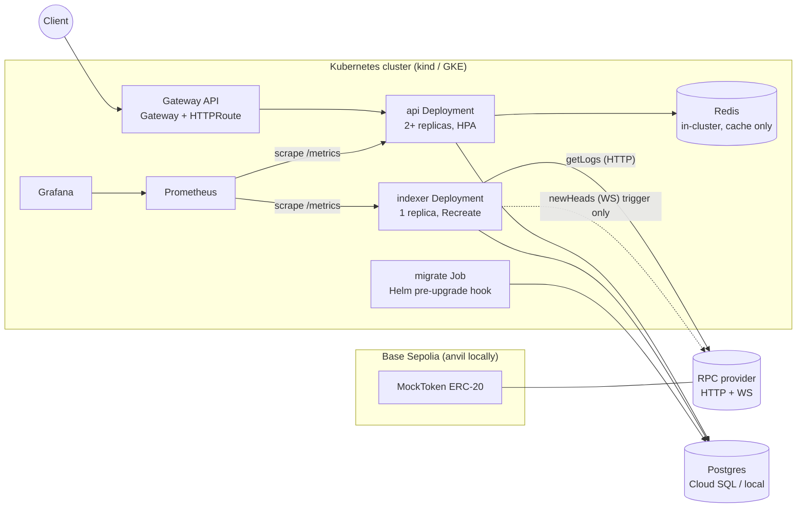

# 02 — Architecture

## System context



## Components

| Component                | Responsibility                                                           | Scaling                                                                                                   |
| ------------------------ | ------------------------------------------------------------------------ | --------------------------------------------------------------------------------------------------------- |
| `apps/indexer`           | Ingest `Transfer` logs into Postgres. The **only** writer of chain data. | Exactly 1 active instance. Enforced by `replicas: 1`, `strategy: Recreate`, and a Postgres advisory lock. |
| `apps/api`               | Read-only HTTP API with a Redis cache.                                   | Stateless. HPA from 2 to 5 replicas on CPU.                                                               |
| `packages/db`            | Drizzle schema, migrations, client factory, migrate entrypoint.          | —                                                                                                         |
| `packages/chain`         | viem clients, the ABI, chain config, and address helpers.                | —                                                                                                         |
| `packages/config`        | Zod env schemas and the `loadConfig()` helper.                           | —                                                                                                         |
| `packages/observability` | Metric registry helpers and the pino logger config.                      | —                                                                                                         |
| `contracts/`             | Foundry: `MockToken`, the deploy script, the transfer-spam script.       | —                                                                                                         |
| `deploy/`                | Helm chart, kind config, monitoring values, dashboards, alert rules.     | —                                                                                                         |
| `infra/terraform/`       | GCP infrastructure.                                                      | —                                                                                                         |

**Rule:** apps depend on packages. Packages never depend on apps, and `packages/*` must not import NestJS (keep them framework-free so they're easy to test).

## Repository layout

Entries marked `(P<n>)` don't exist yet; they are added in that roadmap phase. Everything else is in the skeleton.

```
gapless/
├── CLAUDE.md
├── README.md
├── .editorconfig  .gitignore  .nvmrc  .env.example
├── package.json  pnpm-workspace.yaml  tsconfig.base.json  (P0)
├── docs/                      # these documents + adr/ (+ runbooks.md, P8)
├── apps/
│   ├── indexer/
│   │   ├── src/
│   │   │   ├── main.ts  app.module.ts  verify.ts   (P3)
│   │   │   ├── ingestion/     # range planner, batch processor, reorg handler
│   │   │   ├── head/          # head tracker (WS trigger + poll fallback)
│   │   │   ├── leader/        # advisory-lock leadership
│   │   │   ├── health/        # /healthz /readyz
│   │   │   └── metrics/       # indexer metric definitions
│   │   └── test/
│   │       ├── integration/
│   │       └── chaos/
│   └── api/
│       ├── src/
│       │   ├── main.ts  app.module.ts               (P5)
│       │   ├── transfers/     # controller, service, repository, schemas
│       │   ├── stats/
│       │   ├── cache/
│       │   ├── health/
│       │   ├── metrics/
│       │   └── common/        # problem+json filter, cursor codec, pipes
│       └── test/
│           ├── integration/
│           └── e2e/
├── packages/
│   ├── db/  ├── chain/  ├── config/  └── observability/   # each with src/
├── contracts/                 # Foundry project: src/ script/ test/
├── deploy/
│   ├── helm/gapless/          # app chart: templates/
│   ├── local/                 # kind config, local postgres/redis manifests
│   └── monitoring/            # kube-prometheus-stack values, dashboards/*.json
├── infra/terraform/
│   ├── bootstrap/             # state bucket (run once)
│   └── envs/dev/              # the real environment
├── .github/workflows/
├── renovate.json              (P0)
├── docker-compose.yml         (P1)
└── Makefile                   (P0, targets added per phase)
```

## Data model (Postgres, via Drizzle)

### `transfers`

| Column            | Type                                   | Notes                       |
| ----------------- | -------------------------------------- | --------------------------- |
| `chain_id`        | `integer` not null                     |                             |
| `block_number`    | `bigint` not null                      |                             |
| `block_hash`      | `text` not null                        | `0x…`, lowercase            |
| `block_timestamp` | `timestamptz` not null                 |                             |
| `tx_hash`         | `text` not null                        | lowercase                   |
| `log_index`       | `integer` not null                     |                             |
| `token_address`   | `text` not null                        | lowercase                   |
| `from_address`    | `text` not null                        | lowercase                   |
| `to_address`      | `text` not null                        | lowercase                   |
| `value`           | `numeric(78,0)` not null               | full uint256, never a float |
| `indexed_at`      | `timestamptz` not null default `now()` |                             |

- **Primary key:** `(chain_id, tx_hash, log_index)`. This is the idempotency guarantee.
- **Indexes:**
  - `(chain_id, block_number DESC, log_index DESC)` for the recent feed
  - `(chain_id, from_address, block_number DESC, log_index DESC)`
  - `(chain_id, to_address, block_number DESC, log_index DESC)`
- **Check constraints:** address and hash columns match `^0x[0-9a-f]{40}$` and `^0x[0-9a-f]{64}$`.

### `indexer_checkpoints`

| Column            | Type                   | Notes                                                 |
| ----------------- | ---------------------- | ----------------------------------------------------- |
| `chain_id`        | `integer`              | PK part                                               |
| `token_address`   | `text`                 | PK part                                               |
| `last_block`      | `bigint` not null      | last **fully processed** block                        |
| `last_block_hash` | `text` not null        | used for reorg detection                              |
| `head_block`      | `bigint` not null      | latest chain head seen (for lag reporting by the API) |
| `updated_at`      | `timestamptz` not null |                                                       |

**Migrations:** `drizzle-kit generate` produces SQL files, which are committed and reviewed. Never use `drizzle-kit push` against shared environments. Migrations are **additive-first**: to change a column, add the new one, backfill, switch code, then drop in a later release, so rolling deploys never break.

## API contract (`apps/api`)

Base path `/v1`. JSON responses. All on-chain integers (`value`, `blockNumber`) are **decimal strings**. Addresses are **EIP-55 checksummed** in responses.

| Method & path                          | Query                                                               | Cache                                                                                       |
| -------------------------------------- | ------------------------------------------------------------------- | ------------------------------------------------------------------------------------------- |
| `GET /v1/transfers`                    | `limit` (1–100, default 25), `cursor`                               | Redis, TTL 3s (first page only)                                                             |
| `GET /v1/addresses/:address/transfers` | `direction` = `in`\|`out`\|`all` (default `all`), `limit`, `cursor` | none                                                                                        |
| `GET /v1/stats`                        | —                                                                   | Redis, TTL 5s                                                                               |
| `GET /healthz`                         | —                                                                   | liveness                                                                                    |
| `GET /readyz`                          | —                                                                   | readiness: DB reachable. If Redis is down, the API serves uncached (degraded, still ready). |

**Pagination:** keyset (cursor) only, never offset. The cursor is a base64url-encoded JSON `{ b: blockNumber, l: logIndex }`. Sort order is `block_number DESC, log_index DESC`. Response shape:

```json
{
  "data": [
    {
      "txHash": "0x…",
      "logIndex": 3,
      "blockNumber": "1234",
      "blockTimestamp": "2026-10-21T10:00:00Z",
      "from": "0xAbC…",
      "to": "0xDeF…",
      "value": "1000000000000000000"
    }
  ],
  "nextCursor": "eyJiIjoi…"
}
```

**`/v1/stats`:** `{ chainId, tokenAddress, totalTransfers, lastIndexedBlock, headBlock, lagBlocks, updatedAt }`.

**Errors:** RFC 9457 `application/problem+json` with `type`, `title`, `status`, `detail`, and `errorCode` (for example `INVALID_ADDRESS` or `INVALID_CURSOR`). There's one global exception filter, and stack traces never leave the service.

## Ports

| Process                  | Port | Exposed via Gateway? |
| ------------------------ | ---- | -------------------- |
| api HTTP                 | 3000 | yes (`/v1/*` only)   |
| api metrics + health     | 9464 | no                   |
| indexer metrics + health | 9464 | no                   |

Metrics and health live on a separate internal port so the public route can never expose them.

## Configuration (env vars)

All config is validated at boot by Zod schemas in `packages/config`. An invalid config makes the process exit non-zero immediately.

| Var                   | Used by | Example / default                                                     |
| --------------------- | ------- | --------------------------------------------------------------------- |
| `NODE_ENV`            | all     | `production`                                                          |
| `LOG_LEVEL`           | all     | `info`                                                                |
| `DATABASE_URL`        | all     | `postgres://…` (secret)                                               |
| `METRICS_PORT`        | all     | `9464`                                                                |
| `PORT`                | api     | `3000`                                                                |
| `REDIS_URL`           | api     | `redis://redis:6379`                                                  |
| `CHAIN_ID`            | all     | `84532` (Base Sepolia) / `31337` (anvil)                              |
| `TOKEN_ADDRESS`       | all     | `0x…`                                                                 |
| `RPC_HTTP_URL`        | indexer | secret (contains an API key)                                          |
| `RPC_WS_URL`          | indexer | secret, optional (indexer works without it)                           |
| `START_BLOCK`         | indexer | token deploy block                                                    |
| `CONFIRMATIONS`       | indexer | `5`                                                                   |
| `BATCH_SIZE`          | indexer | `2000` (max blocks per `getLogs`)                                     |
| `POLL_INTERVAL_MS`    | indexer | `4000`                                                                |
| `REORG_REWIND_BLOCKS` | indexer | `64`                                                                  |
| `SHUTDOWN_TIMEOUT_MS` | all     | `20000` (must be less than the pod's `terminationGracePeriodSeconds`) |

Keep this table in sync with `packages/config` and `.env.example`.
